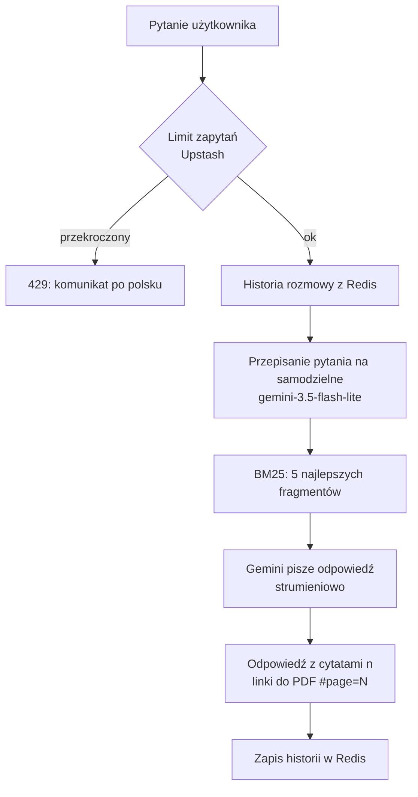

# Harcerski czatbot

Czatbot, który odpowiada na pytania harcerzy, drużynowych i rodziców na podstawie publicznych dokumentów ZHP (Statut, Safe from Harm, Podstawy Wychowawcze, instrukcje TiPi). Każda odpowiedź ma cytaty [n] z linkiem do właściwej strony PDF.

Technologie: Next.js, wyszukiwanie BM25, Google Gemini, Upstash Redis (historia rozmowy i limity zapytań).

## Uruchomienie lokalne

Wymagania: Node 24.

1. Utwórz plik `.env`:

   ```
   GEMINI_API_KEY=...
   UPSTASH_REDIS_REST_URL=...
   UPSTASH_REDIS_REST_TOKEN=...
   ```

   Klucz Gemini: aistudio.google.com. Dane Redis: console.upstash.com (baza → REST API).

2. Zainstaluj i uruchom:

   ```bash
   npm install
   npm run dev
   ```

Aplikacja działa na http://localhost:3000.

## Wdrożenie (Vercel)

1. Wgraj projekt do repozytorium na GitHubie i zaimportuj je na vercel.com.
2. W *Settings → Environment Variables* dodaj te same trzy zmienne co w `.env`.
3. Kliknij *Deploy*. Kolejne wdrożenia uruchamiają się po każdym pushu.

## Działanie



## Pamięć

- **Rozmowa** (pytania, odpowiedzi i źródła) w Upstash Redis pod kluczem `chat:<losowe id>`. Wygasa po 7 dniach od ostatniego pytania. Przycisk „Wyczyść historię” usuwa ją od razu.
- **Ciasteczko** `chat_id` z losowym UUID: `httpOnly`, `sameSite: lax`, ważne 30 dni. Nie ma w nim nic poza id.
- **Liczniki limitów** w Redis, po adresie IP. Wygasają razem z oknem (minuta albo dzień). IP nie jest zapisywane przy rozmowie.
- **Do Google Gemini** trafia pytanie z fragmentami dokumentów, a do modelu od przepisywania ostatnie 4 wiadomości rozmowy. Strona prosi, żeby nie wpisywać danych osobowych.

## Limity użycia

| Limit | Wartość |
|---|---|
| Na IP | 5 na minutę i 20 dziennie |
| Globalnie | 100 dziennie |
| Długość pytania | 500 znaków |

## Licencja

Kod: [MIT](LICENSE). Dokumenty w `data/sources/` należą do Związku Harcerstwa Polskiego i są tu tylko jako źródło odpowiedzi czatbota.